<div align="center">

# AXI4-Lite Slave IP
### Modular memory-mapped peripheral in SystemVerilog


**Design · Simulation · Assertions · Synthesis**

</div>

---

## Overview

A parameterized AXI4-Lite slave RTL design with a default 32-bit address/data configuration, a 16-word memory-mapped register bank, byte-enabled writes, separate read/write channel logic, and SystemVerilog Assertions (SVA) for response stability under backpressure.

| Property | Configuration |
|---|---|
| Address/data width | 32 / 32 bits |
| Register bank | 16 × 32-bit registers |
| Valid word addresses | `0x00` through `0x3C`, in 4-byte increments |
| Byte enables | 4-bit `WSTRB` |
| Responses | `OKAY` (`2'b00`), `SLVERR` (`2'b10`) |
| Tools | Verilator, Yosys |

> **Scope:** AXI4-Lite single-beat transactions. The design allows at most one outstanding write transaction and one outstanding read transaction independently, so read and write activity can overlap. It does not implement AXI4 bursts or transaction IDs. The current SVA checker has a fixed 32-bit `rdata` input, so the checker must be updated before verifying a different data width.

## Architecture

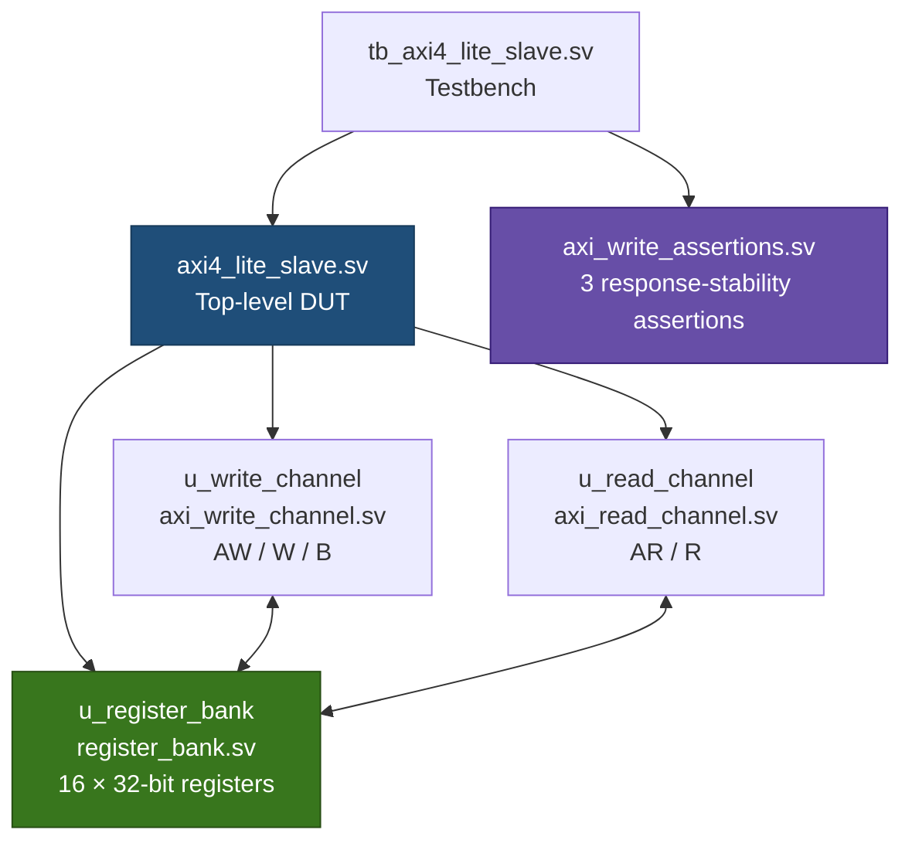

The DUT's child instances are `u_write_channel`, `u_read_channel`, and `u_register_bank`. The SVA checker is instantiated in the testbench alongside the DUT; it is **not** instantiated inside `axi4_lite_slave`.

## Repository map

```text
AXI4-Lite/
├── rtl/
│   ├── axi4_lite_slave.sv       # Top-level integration
│   ├── axi_write_channel.sv     # Write address/data/response handling
│   ├── axi_read_channel.sv      # Read address/data response handling
│   ├── register_bank.sv         # Storage, address checks, byte writes
│   ├── axi_write_assertions.sv  # SVA checker
│   └── axi_pkg.sv               # Package file (not used by current build)
├── tb/
│   └── tb_axi4_lite_slave.sv    # Directed self-checking testbench
├── reports/
│   ├── axi4_lite_slave_synth.v  # Synthesized Verilog netlist
│   └── yosys_synthesis.log      # Synthesis log
├── waveforms/                   # Generated waveforms
├── Makefile
├── .gitignore
└── README.md
```

## AXI4-Lite handshake fundamentals

Each channel transfers information on a rising clock edge when `VALID && READY` is true. If `VALID=1` and `READY=0`, the transfer has not completed; the sender must keep the offered information stable until acceptance.

| Channel | Main signals | Purpose |
|---|---|---|
| AW | `s_axi_awaddr`, `s_axi_awvalid`, `s_axi_awready` | Write address |
| W | `s_axi_wdata`, `s_axi_wstrb`, `s_axi_wvalid`, `s_axi_wready` | Write data and byte enables |
| B | `s_axi_bresp`, `s_axi_bvalid`, `s_axi_bready` | Write status response |
| AR | `s_axi_araddr`, `s_axi_arvalid`, `s_axi_arready` | Read address |
| R | `s_axi_rdata`, `s_axi_rresp`, `s_axi_rvalid`, `s_axi_rready` | Read data and status |

AW and W are independent: the address and data may handshake in the same cycle or different cycles.

## Write path

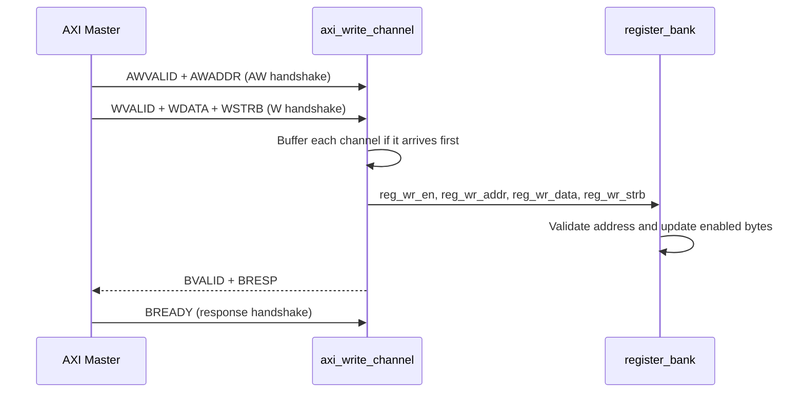

### Write-control flowchart

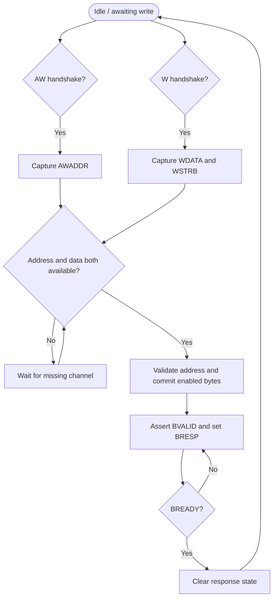

The core write control is:

```systemverilog
assign s_axi_awready = !aw_pending && !response_pending;
assign s_axi_wready  = !w_pending  && !response_pending;

assign aw_handshake = s_axi_awvalid && s_axi_awready;
assign w_handshake  = s_axi_wvalid  && s_axi_wready;

assign write_commit =
    !response_pending &&
    (aw_pending || aw_handshake) &&
    (w_pending  || w_handshake);
```

- `aw_pending` records that an address was captured.
- `w_pending` records that write data and strobes were captured.
- `write_commit` is true when both address and data are available, including when one arrives in the current cycle.
- `response_pending` prevents another write from being accepted while a write response is outstanding.
- The response is `OKAY` for a valid address and `SLVERR` for an invalid address.

### Byte-enabled writes

For 32-bit data, `WSTRB[0]` enables bits `[7:0]`, `WSTRB[1]` enables `[15:8]`, `WSTRB[2]` enables `[23:16]`, and `WSTRB[3]` enables `[31:24]`.

```systemverilog
if (wr_strb[byte_lane]) begin
    regs[wr_index][byte_lane*8 +: 8]
        <= wr_data[byte_lane*8 +: 8];
end
```

Only selected bytes change; the other bytes retain their previous values.

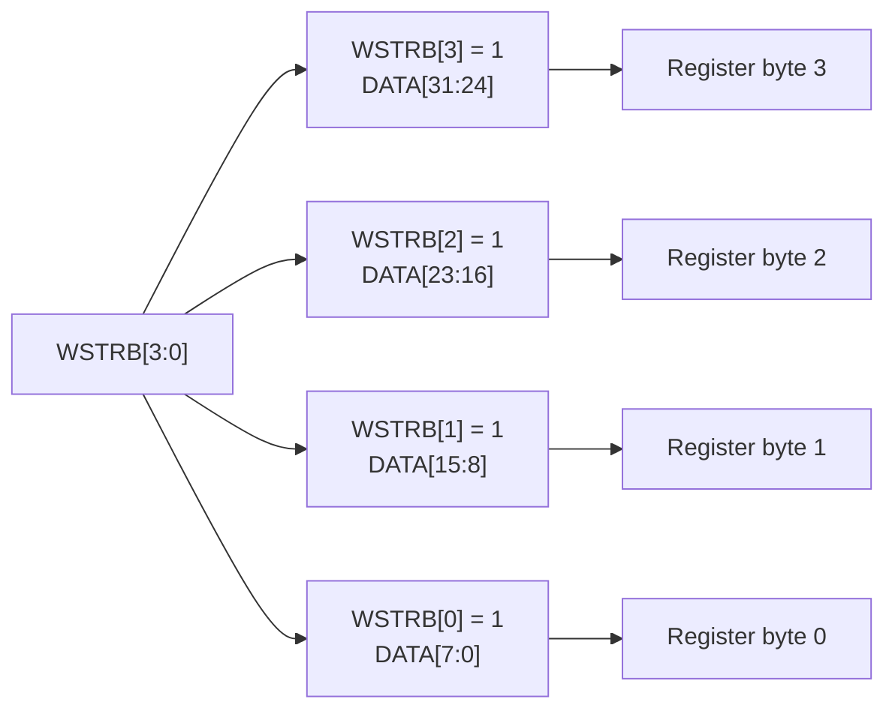

A `WSTRB` bit of `0` leaves its corresponding byte unchanged; a bit of `1` updates that byte from `WDATA`.

## Read path

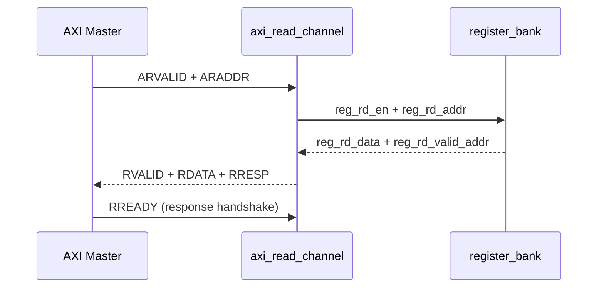

### Read-control flowchart

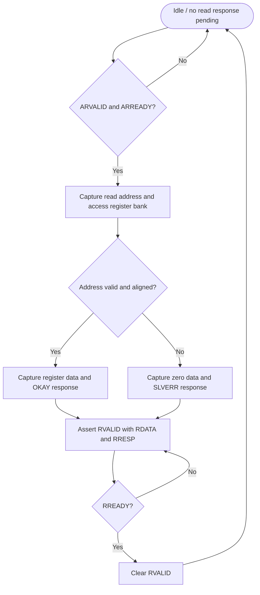

`axi_read_channel` accepts a read address when no response is pending:

```systemverilog
assign s_axi_arready = !s_axi_rvalid;
assign ar_handshake  = s_axi_arvalid && s_axi_arready;

assign reg_rd_en   = ar_handshake;
assign reg_rd_addr = s_axi_araddr;
```

On acceptance, the channel captures read data and response status and asserts `s_axi_rvalid`. The response is held until `s_axi_rvalid && s_axi_rready`. Read and write channel logic are separate, so read and write activity can overlap.

## Register bank and address map

The storage array is:

```systemverilog
logic [DATA_WIDTH-1:0] regs [0:NUM_REGS-1];
```

For 32-bit words, each register occupies four bytes. Valid aligned addresses are `0x00`, `0x04`, …, `0x3C`; unaligned addresses and addresses outside the implemented window are invalid.

### Register address map

| Register index | Byte address | Register width |
|---:|---:|---:|
| 0 | `0x00` | 32 bits |
| 1 | `0x04` | 32 bits |
| 2 | `0x08` | 32 bits |
| 3 | `0x0C` | 32 bits |
| 4 | `0x10` | 32 bits |
| 5 | `0x14` | 32 bits |
| 6 | `0x18` | 32 bits |
| 7 | `0x1C` | 32 bits |
| 8 | `0x20` | 32 bits |
| 9 | `0x24` | 32 bits |
| 10 | `0x28` | 32 bits |
| 11 | `0x2C` | 32 bits |
| 12 | `0x30` | 32 bits |
| 13 | `0x34` | 32 bits |
| 14 | `0x38` | 32 bits |
| 15 | `0x3C` | 32 bits |

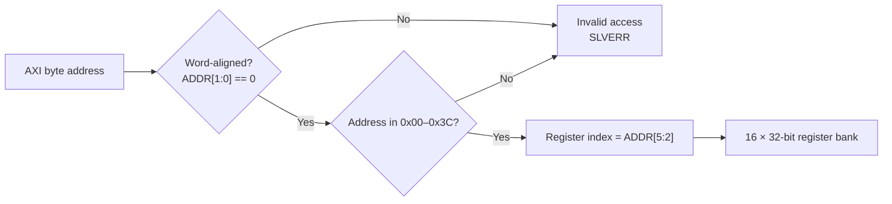


- Valid access: `OKAY` (`2'b00`).
- Invalid access: `SLVERR` (`2'b10`).
- Invalid read: zero data and `SLVERR`.
- `rst_n` is active-low and asynchronously resets the register bank and channel state.

## SystemVerilog Assertions (SVA)

`axi_write_assertions.sv` contains three properties. The testbench connects `check_enable` to `rst_n`.

### 1. `BRESP` remains stable during write backpressure

```systemverilog
property p_bresp_stable_under_backpressure;
    @(posedge clk)
    (check_enable && bvalid && !bready)
    |=> (!check_enable || (bvalid && $stable(bresp)));
endproperty
```

If `BVALID` is high and `BREADY` is low, the next sampled cycle must still have `BVALID` high and `BRESP` unchanged, unless checking has been disabled.

### 2. `BVALID` stays high during write backpressure

```systemverilog
property p_bvalid_stays_high_under_backpressure;
    @(posedge clk)
    (check_enable && bvalid && !bready)
    |=> (!check_enable || bvalid);
endproperty
```

The slave must not withdraw a pending write response before the master accepts it.

### 3. `RDATA` and `RRESP` remain stable during read backpressure

```systemverilog
property p_rresp_stable_under_backpressure;
    @(posedge clk)
    (check_enable && rvalid && !rready)
    |=> (!check_enable ||
         (rvalid && $stable(rdata) && $stable(rresp)));
endproperty
```

While a read response is stalled, `RVALID`, `RDATA`, and `RRESP` must remain stable across the next sampled clock.

**Operators:** `@(posedge clk)` samples on the rising edge; `|=>` is non-overlapped implication (the consequent starts at the next sample); `$stable(x)` checks that `x` did not change between relevant samples.

### Backpressure timing concept

The following timing sketch illustrates the required behavior while the master is not ready. The response and payload must remain stable until the handshake occurs.

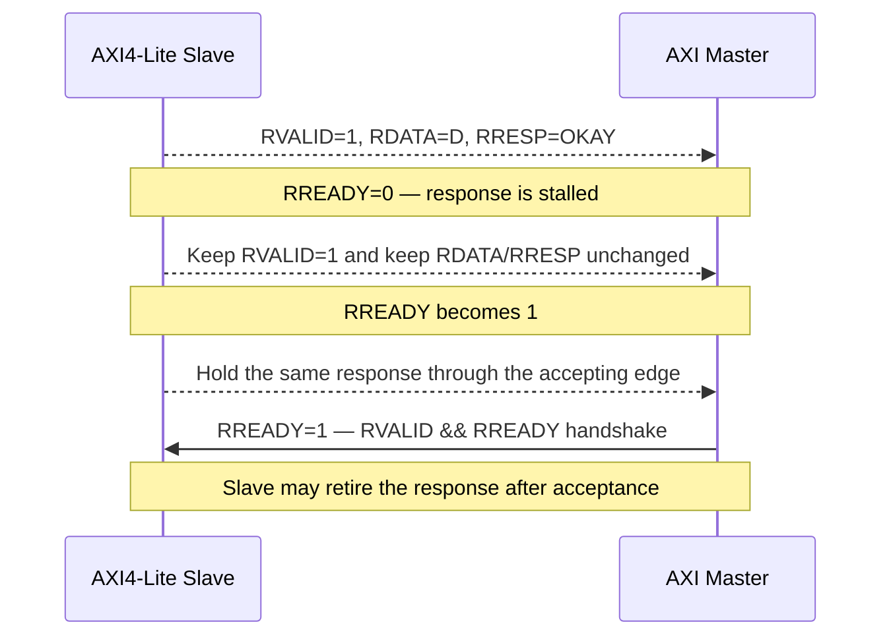

> These assertions cover response stability under backpressure. They do not check every AXI4-Lite rule and are not a complete formal proof. They are currently run in Verilator simulation.

## Testbench and regression

`tb/tb_axi4_lite_slave.sv` instantiates the DUT and the SVA checker and runs 12 directed scenarios:

1. Reset register value
2. Full-word write/readback
3. `WSTRB` partial-byte write
4. Invalid address responses
5. Independent channels — AW first
6. Independent channels — W first
7. Write-response backpressure
8. Read-response backpressure
9. Register boundaries and unaligned addresses
10. Reset during pending transactions
11. Consecutive writes, overwrite, and reads
12. Concurrent read and write activity

**Last recorded regression:** 12/12 directed tests passed with Verilator and assertions enabled. Re-run the commands below to reproduce the result.

## Run locally

Requirements: Verilator with timing/assertion support, a compatible C++ compiler, and GNU Make. Yosys is needed only if regenerating the synthesis artifacts.

```bash
make lint    # lint RTL and testbench
make test    # lint, build, and run simulation
make clean   # remove obj_dir and generated VCD waveforms
```

To run an already-built executable:

```bash
./obj_dir/Vtb_axi4_lite_slave
```

Run `make build` or `make test` first if `obj_dir/` has been removed.

## Synthesis artifacts

- `reports/yosys_synthesis.log` — recorded Yosys output.
- `reports/axi4_lite_slave_synth.v` — synthesized Verilog netlist.

These are synthesis artifacts only. Place-and-route, timing sign-off, and GDSII generation are not claimed.

## Verification and synthesis results

### 1. Functional regression

The last recorded Verilator regression passed all 12 directed tests with assertions enabled. Re-run `make test` to reproduce the result.

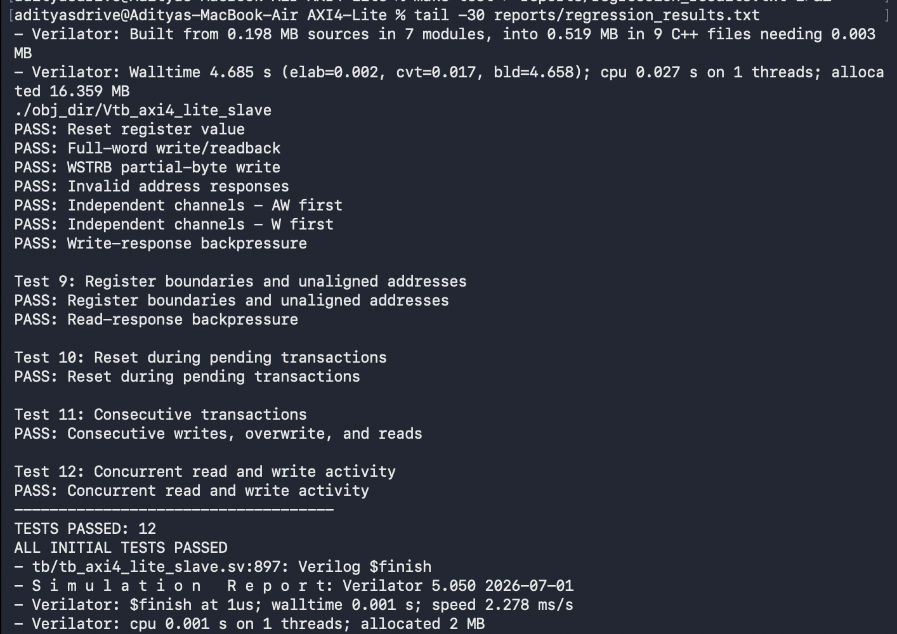

### 2. Full simulation waveforms

Read and write activity captured in GTKWave.

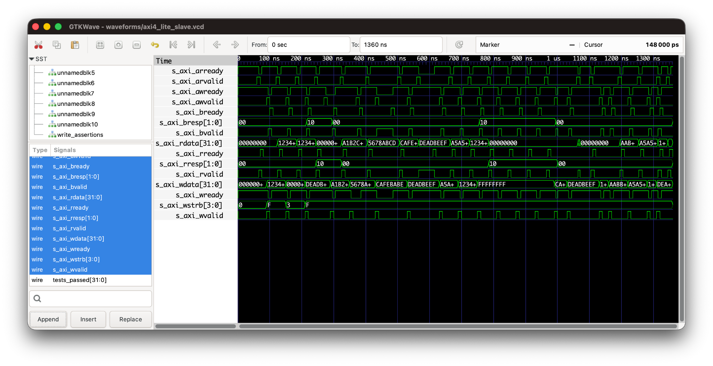

### 3. Read-response backpressure

The captured read-response interval demonstrates `RVALID` asserted while `RREADY` is low, with `RDATA` and `RRESP` held stable.

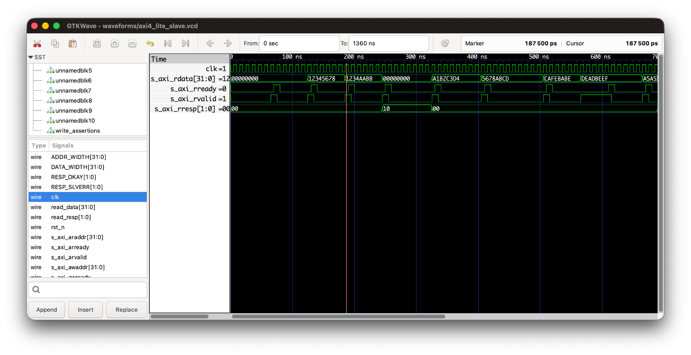

### 4. Yosys synthesis statistics

The saved Yosys log reports **1,935 generic synthesized cells** across the design hierarchy. This is a generic synthesis statistic, not a standard-cell area or physical-design result.

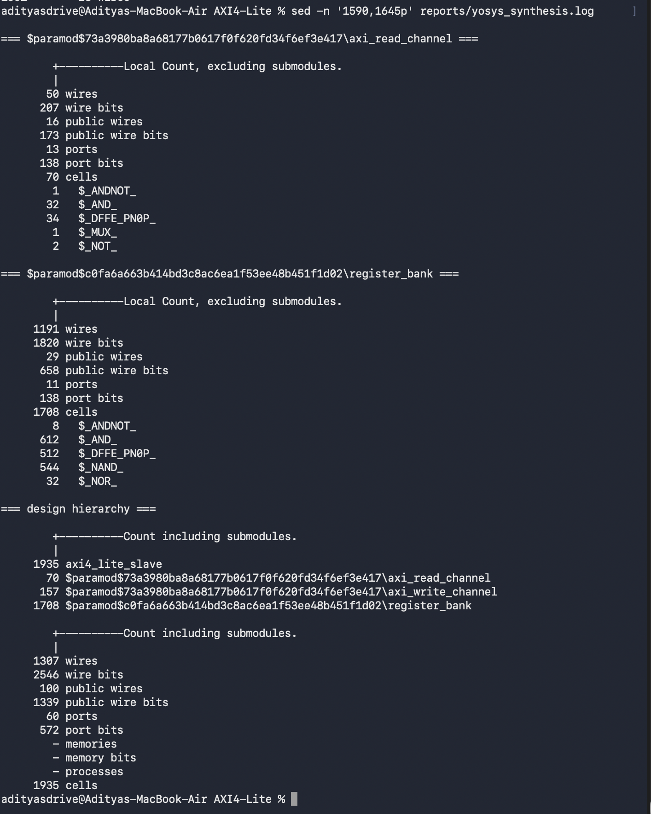

### 5. Yosys structural checks

The saved Yosys log reports zero structural problems during its checks.

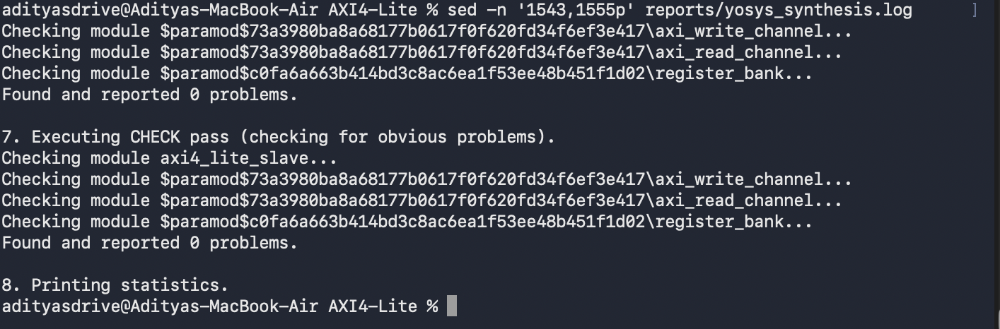

> **Implementation status:** RTL simulation, assertion checking in simulation, and generic Yosys synthesis have been run. This repository does not claim completed place-and-route, timing sign-off, or GDSII generation.


---

<div align="center">Built with SystemVerilog · Simulated with Verilator · Synthesized with Yosys</div>
